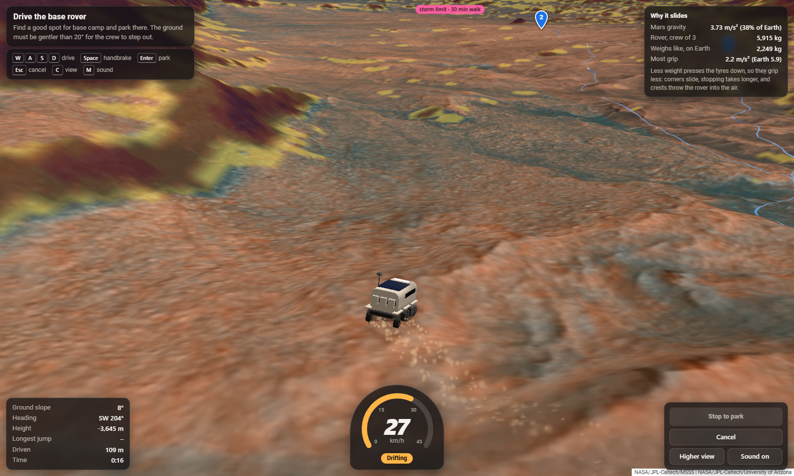

# Mars Explorer: A Mars EVA Planner

NASA Space Apps Hackathon entry: **Mars Explorer: A Mars EVA Planner**, a planning screen a Mars crew would use in the habitat before walking out to study the boxwork formations on Mount Sharp, Gale Crater.

The crew picks a base camp and science stops on the map. The planner finds a walking route that avoids steep ground, checks it against life support and daylight, and draws the **turn-back line**: the farthest the crew can go, do the planned work, and still walk back in time. Everything is computed from data NASA's Curiosity rover and orbiters collected at this exact place.


The screen is written for people with no space background and laid out like a consumer maps app: a full-screen map with one floating panel. The panel shows only what is needed to decide (the verdict, the total time and distance, and the list of stops, like a directions list). Everything else opens on request: walk settings, the day's weather, the solar storm test, charts along the route, map layers and photos of a place.

The map is 3D, in the manner of a globe viewer: NASA's imagery is draped over the real shape of the ground, built from the same 1 m elevation data the planner uses. Drag to move, scroll to zoom, and right-drag (or hold Ctrl and drag) to tilt and turn the view. The route, the turn-back line and the storm limit follow the terrain, and a 2D button returns to a plain top-down map.

## What a crew can do with it

- **Plan a route on foot.** Click the map to add science stops or move base camp. The route follows the fastest walkable ground between steep slopes, and shows distance, climb, walking time and arrival time at each stop.
- **See how far is safe.** Ground beyond the turn-back line is dimmed. Each stop gets a "leave by" time. Rings showing how many minutes on foot each place is from shelter can be switched on in the map key.
- **Get a clear verdict.** "Safe to go", "Tight" or "Not safe", with the reason in one sentence. If the plan runs too long, the map marks where and when to turn back.
- **Choose a display theme.** Switch between light and dark mode from the panel header; the choice is remembered on this device.
- **Run a solar storm drill.** Choose where the crew is when an alert arrives. The planner shows the fastest way back and whether they reach shelter within the warning time. The storm itself is the real one Curiosity recorded on 20 May 2024.
- **Plan against real conditions.** Pick any Martian day (sol) since 2012 and the planner uses the temperature, daylight and radiation Curiosity measured then.
- **Look before you go.** For any point, see the photos Curiosity took from the nearest place it stood, labelled by compass direction.
- **Share a plan.** Copy a link or save a JSON route file. Load a route file to restore its camp, stops, walk settings and sol.
- **Drive the base rover.** Take the crew's pressurised rover for a drive in 3D with W, A, S and D, racing-game style, and park it where base camp should be. The planner then replans from the new spot. See [Driving the base rover](#driving-the-base-rover).

## How it answers the challenge

| The brief asks for | In this tool |
|---|---|
| A science goal and a matching location | Sampling boxwork ridges and hollows on Mount Sharp, where Curiosity has worked since 2025. Preset stops are Curiosity's own drill sites (Altadena, Nevado Sajama and Valle de la Luna, Antofagasta crater). |
| At least three kinds of data, layered | Optical (25 cm colour imagery, rover photos), topographic (1 m elevation, slope), atmospheric (daily weather), radiation (surface dose rate, solar storm). |
| Astronaut safety, radiation and space weather | Turn-back line, walk-back rings, storm line, storm drill, radiation dose for the planned EVA. |
| Suited mobility and a route that avoids obstacles | Walking speed set by the crew and slowed by slope; ground steeper than the crew's limit is no-go. |
| A habitat display, tablet or HUD | A habitat planning screen. |
| Rover point-of-view images | Curiosity's Navcam views in eight compass directions at its stops. |
| Rovers and working in pairs | Base camp is a pressurised rover for a crew of three, which can be driven in 3D over the real terrain to choose where it parks. |

## Run it

You need Python 3.12 and Node.js 20.19 or newer. The prepared data is in the repository, so nothing has to be downloaded first. Map imagery and photos load from NASA servers, so you need to be online.

```powershell
# 1. Backend (from the repository root)
python -m venv backend\.venv
backend\.venv\Scripts\python -m pip install -r backend\requirements.txt
backend\.venv\Scripts\python -m uvicorn app.main:app --app-dir backend --host 0.0.0.0 --port 8001

# 2. Frontend (second terminal)
cd frontend
npm install
npm run dev
```

Open http://localhost:5173. On macOS or Linux use `backend/.venv/bin/python` instead of `backend\.venv\Scripts\python`.

If port 8000 is already in use in your environment, the app is configured to use port 8001 instead. To serve everything from one port, run `npm run build` in `frontend` and open http://localhost:8001. The backend serves the built frontend when `frontend/dist` exists.

## Apps for Windows, macOS and Android

The planner also comes as an app that runs entirely on the device, with nothing to install first. Map imagery and photos still load from NASA's servers, so the device must be online.

Download the apps from GitHub: open the **Releases** tab, choose **The app for your device (Windows/MAc/Android**.

- **Windows 10 or 11:** run `MarsEVAPlanner.exe`. The app is not signed, so Windows may warn about an unknown publisher: choose *More info*, then *Run anyway*. It needs the Microsoft Edge WebView2 Runtime, which Windows normally includes.
- **macOS on Apple silicon (M1 or later):** open `Mars-EVA-Planner-mac.dmg` and drag the app to Applications. The app is not signed by Apple, so the first time, try to open it, then go to *System Settings > Privacy & Security* and choose *Open Anyway*.
- **Android 7.0 or newer:** copy `Mars-EVA-Planner-android.apk` to the phone and open it, allowing installs from that source when asked. The first start takes up to a minute while the app unpacks.

Each app starts the planner's Python backend on the device at `127.0.0.1` and shows the page from it: in its own window on Windows and macOS (pywebview, packed by PyInstaller, in `desktop/`), and in a full-screen web view on Android (Python by Chaquopy, in `android/`). Android has no builds of the newest numpy, scipy and pydantic, so the Android app runs Python 3.10 with older versions of them (`android/app/requirements.txt`). The build checks that the backend's tests pass with both sets, and that each app starts and plans a walk; the Android app is checked on an emulator.

To build the Windows or Mac app yourself, on that system, from the repository root:

```powershell
cd frontend; npm run build; cd ..
python -m venv desktop\.venv
desktop\.venv\Scripts\python -m pip install -r desktop\requirements.txt
desktop\.venv\Scripts\pyinstaller desktop\mars-eva-planner.spec --noconfirm   # the app is then in dist\
```

The Android app needs JDK 17, the Android SDK, Gradle 8.11 and Python 3.10: build the frontend, then run `gradle assembleDebug` in `android/`.

## How it is built

The project is two separate parts with a small HTTP API between them.

```
backend/   Python. Owns all NASA data and every calculation.
frontend/  TypeScript. Draws the map, panels and charts and sends the plan to the backend.
```

**Backend** (FastAPI, NumPy, SciPy): loads the terrain grid, searches routes, works out time limits, the safe-return area and storm exposure, and looks up rover photos. Interactive API documentation is at http://localhost:8001/docs.

| Endpoint | What it returns |
|---|---|
| `GET /api/site` | Study area, map layers, rover path and sites, default plan, setting ranges, data sources |
| `GET /api/conditions?sol=` | Weather and background radiation measured on a sol |
| `GET /api/conditions/history` | Long-term temperature and radiation series |
| `POST /api/plan` | Route, timings, verdict, turn-back point, storm exposure, safe-return area |
| `POST /api/escape` | Fastest way back to base camp from a position, judged against the storm warning |
| `GET /api/photos?lat=&lon=` | Curiosity's photos from its nearest stop |
| `GET /api/terrain/{z}/{x}/{y}.png` | Elevation as terrain-RGB map tiles, from which the 3D ground surface is built |
| `GET /api/terrain/heights.bin` | The whole elevation grid (16-bit, gzip, about 1.7 MB) for the drive mode's physics; its layout is in `/api/site` |

**Frontend** (TypeScript, Vite, MapLibre GL for the 3D map, three.js for the drivable rover, no UI framework): holds only the plan being edited. `src/types.ts` mirrors the API responses.

## NASA data used

| Used for | Dataset | From |
|---|---|---|
| Elevation and slope | [MSL Gale Merged DEM, 1 m](https://astrogeology.usgs.gov/search/map/mars_msl_gale_merged_dem_1m), from HiRISE stereo images | USGS Astrogeology / MSL project |
| Colour imagery, regional imagery, place names | [Curiosity location map](https://mars.nasa.gov/maps/location/?mission=MSL) tiles (HiRISE colour, CTX) | NASA/JPL-Caltech/University of Arizona/MSSS |
| Rover stops, driven path, tilt | [Curiosity waypoints](https://mars.nasa.gov/mmgis-maps/MSL/Layers/json/MSL_waypoints.json) and traverse | NASA/JPL-Caltech |
| Temperature, pressure, UV, sunrise, sunset | [REMS daily weather report](https://mars.nasa.gov/rss/api/?feed=weather&category=msl&feedtype=json), 4,745 sols | NASA/JPL-Caltech/CAB |
| Radiation dose rate, May 2024 solar storm | [RAD reduced data records](https://pds-ppi.igpp.ucla.edu/data/MSL-M-RAD-3-RDR-V1.0/) | NASA PDS Planetary Plasma Interactions node / SwRI |
| Ground photos | [Curiosity raw images](https://mars.nasa.gov/msl/multimedia/raw-images/) | NASA/JPL-Caltech (Navcam), NASA/JPL-Caltech/MSSS (Mastcam) |

Site names and descriptions come from NASA's Curiosity mission blog (links are in the map popups).

## How the planner decides

- **Terrain.** The study area is 3.9 by 4.2 km around Curiosity's boxwork sites, on a grid of 4 m cells. Each cell holds its mean elevation and its steepest slope, taken from the 1 m elevation data after smoothing to that data's real resolution (about 3 m).
- **No-go ground.** Cells steeper than the crew's slope limit (default 20°) cannot be entered.
- **Walking speed.** Speed on level ground is a setting (default 0.8 m/s). Slopes change it by Tobler's hiking function, so uphill and downhill differ and the way out and the way back are searched separately.
- **Route.** Dijkstra's shortest-path search over the grid, minimising walking time. A search of the whole area takes about 0.15 seconds.
- **Time limit.** The tighter of usable life support (capacity minus reserve) and daylight (back before sunset minus a buffer). Sunrise and sunset are the measured values for the chosen sol.
- **Turn-back line.** The edge of the area where walking there, doing the planned work and walking back fits inside the time limit.
- **Storm line.** The edge of the area from which base camp can be reached within the storm warning time.
- **Radiation.** The dose for an EVA is the background dose rate Curiosity measured around that sol times the hours outside. Sieverts are estimated with a mean quality factor of 3.05 (Hassler et al. 2014).

### Checked against the rover

At Curiosity's 263 stops inside the study area, the terrain grid differs from the elevation the rover recorded by 0.06 m on average. Slope on the grid at those stops (median 9.5°) matches the tilt the rover measured (median 8.6°), with a correlation of 0.53. Run `build_terrain.py validate` to reproduce this.

### What the radiation data shows

- Background dose rate at the surface follows the solar cycle: about 8.5 µGy/h in 2012, 13 µGy/h at solar minimum in 2020, and about 6 µGy/h in 2024 to 2026.
- In the 20 May 2024 storm the dose rate rose from 5.5 to 351 µGy/h (64 times) within 54 minutes. Over 44 hours the event added about 1.7 mGy, as much as 13 sols of normal background.

## Driving the base rover

Press **Drive the rover** (or click the base camp pin). The planner steps aside and the crew's rover appears in 3D on the real ground, with a chase camera behind it.



| Key | Does |
|---|---|
| W / S | Accelerate / brake, then reverse |
| A / D | Steer (front and rear axles both turn) |
| Space | Handbrake, for sliding turns |
| Enter | Park here and make it base camp |
| Esc | Cancel; base camp stays where it was |
| C, M | Higher view; sound on or off |

It plays like a racing game because Mars makes it one. The physics (`frontend/src/rover-physics.ts`) uses real Mars gravity, 3.73 m/s² ([NASA Mars fact sheet](https://nssdc.gsfc.nasa.gov/planetary/factsheet/marsfact.html)). Tyres can only push as hard as the weight pressing them down allows, so with gravity at 38 % of Earth's, so is the grip:

- **Braking** from 43 km/h takes about 29 m, against 11 m on Earth.
- **Corners slide**: the tyres hold at most 2.2 m/s² sideways (Earth: 5.9).
- **Crests throw the rover into the air**: where the ground falls away faster than Mars gravity pulls, the wheels leave it.
- **Slopes**: the parking brake holds on ground up to 31° (where the slope's tangent equals the grip); steeper, the rover slides.

Everything is a real force: motor power, grip, rolling resistance, the thin air's drag and gravity along the slope, on the same 4 m elevation grid the planner uses. The rover can only be parked on ground gentle enough for the crew to step out (the crew's slope limit). Its speed is electronically limited to 45 km/h, faster than pressurised rover concepts plan (10 to 20 km/h), for the game.

**How heavy is the rover?** No three-person Mars rover has been built, so its mass is an estimate (`backend/app/site.py`), scaled from NASA's [Space Exploration Vehicle](https://en.wikipedia.org/wiki/Space_Exploration_Vehicle) concept, which is commonly listed at about 3,000 kg for two crew:

| Part | kg |
|---|---|
| Chassis, six wheels, suspension and hub motors | 1,500 |
| Pressurised cabin for three, with three suitports | 1,600 |
| Batteries for a three-day traverse | 900 |
| Life support, heating and cooling, computers and radios | 600 |
| Water wall round the bunks, used as a solar-storm shelter | 500 |
| Crew of three (80 kg each) | 240 |
| Three spacesuits (125 kg each) | 375 |
| Food, water, oxygen and rock samples | 200 |
| **Total** | **5,915** |

On Mars it weighs what 2,249 kg would on Earth. The mass matters most at speed, where the six 10 kW motors run out of power: 0 to 45 km/h takes about 11 seconds.

## Limits to know about

- Slopes come from 1 m elevation data. Rocks and ledges smaller than a few metres, and soft sand, are not seen.
- The 3D view draws heights 1.5 times taller than life so low ridges are easy to see. Outside the framed study area there is no elevation data, so the ground there simply continues the area's overall tilt. The 3D map needs a browser with WebGL.
- The walking model was derived for hikers on Earth. Suited walking on Mars is uncertain, which is why speed and slope limit are settings.
- Conditions are a replay of measured sols, not a forecast. Weather is daily minimum and maximum only.
- Background radiation is one reading every second sol, smoothed over 40 sols. The storm drill uses one recorded event and counts dose outdoors only; shielding inside the shelter is not modelled.
- The storm warning time is an assumption the crew sets.
- In the drive mode, the rover's mass, power and grip are estimates, and the ground is treated as firm everywhere (no soft sand, no rocks smaller than the 4 m grid). Driving needs a keyboard (or the on-screen pads on a touch screen) and a graphics card that handles WebGL.
- In the apps, *Copy link* gives a link that works only on that device while the app is open; share a route file instead. The Android app is a test build, signed with a development key: fine for installing by hand, not for the Play Store. Some Android 15 and newer phones use 16 KB memory pages, which the app's numpy and scipy builds may not load on.

## Rebuilding the data

The files in `backend/data` are produced by scripts in `backend/pipeline`. Run them only to refresh the data. Raw downloads are cached in `backend/data/cache`, which git ignores.

```powershell
backend\.venv\Scripts\python backend\pipeline\build_rover.py      # rover stops, path, study sites
backend\.venv\Scripts\python backend\pipeline\build_weather.py    # daily weather
backend\.venv\Scripts\python backend\pipeline\build_terrain.py    # elevation and slope; downloads about 330 MB
backend\.venv\Scripts\python backend\pipeline\build_radiation.py  # radiation; downloads about 520 MB
backend\.venv\Scripts\python backend\pipeline\build_photos.py     # photos for the named sites
```

The elevation file is 3.9 GB, so `build_terrain.py` downloads only the rows that cover the study area.

## Tests

The drive-mode physics tests run each case twice, on Mars and with Earth gravity, so the effect of gravity is checked rather than assumed. `npm test` needs Node.js 23.6 or newer, which runs TypeScript directly.

```powershell
backend\.venv\Scripts\python -m unittest discover -s backend/tests -v   # planner, mission logic, terrain, rover, 27 tests
cd frontend; npm run typecheck                                          # TypeScript
cd frontend; npm test                                                   # drive-mode physics, Mars against Earth, 7 tests
```

## Repository layout

```
backend/
  app/         API (main.py), route search (planner.py), mission logic (mission.py),
               conditions, photos, terrain, elevation for the 3D map and the drive mode (relief.py),
               site description and the base rover (site.py)
  pipeline/    scripts that build backend/data from NASA sources
  data/        prepared data: terrain grid, weather, radiation, rover stops, photo lists
  tests/
frontend/
  src/         main.ts (wiring), map.ts, panels.ts, charts.ts, api.ts, types.ts, permalink.ts,
               drive.ts (the drive mode: 3D rover, camera, dashboard), rover-physics.ts
  tests/       drive-mode physics tests
desktop/       the Windows and Mac app: launcher.py (window), mars-eva-planner.spec (PyInstaller), icon
android/       the Android app: MainActivity.java (web view), android_server.py, Gradle build, emulator check
.github/       build-apps.yml: builds and checks all three apps
docs/          screenshots of the planner and the drive mode
```

## Credits

**Data and imagery.** Each dataset and who made it is listed under [NASA data used](#nasa-data-used). Some of it belongs to NASA's partners rather than to NASA, and is used here under the owner's terms:

| Material | Owner | Terms |
|---|---|---|
| Navcam photos, place names, rover path and other NASA/JPL-Caltech material | NASA/JPL | [JPL image use policy](https://www.jpl.nasa.gov/jpl-image-use-policy): free for any use with credit, without implying NASA endorsement |
| HiRISE colour imagery | University of Arizona | [Public domain](https://uahirise.org/media/usage.php); credit requested |
| CTX regional imagery, Mastcam photos | Malin Space Science Systems (MSSS) | [Free for educational and personal use](https://www.msss.com/policies/index.html), with credit |
| 1 m elevation model | USGS Astrogeology | Public domain (US government work) |
| REMS weather, RAD radiation | CAB (Spain), SwRI | Mission data published by NASA |

The Mars gravity and air density come from [NASA's Mars fact sheet](https://nssdc.gsfc.nasa.gov/planetary/factsheet/marsfact.html). The Space Exploration Vehicle's mass (about 3,000 kg) comes from [Wikipedia](https://en.wikipedia.org/wiki/Space_Exploration_Vehicle); only that figure is used.

**Software.** All of these are open source and installed by npm or pip, not copied into this repository.

- Frontend: [MapLibre GL JS](https://maplibre.org/) (BSD-3-Clause) for the map and [three.js](https://threejs.org/) (MIT) for the 3D rover, built with Vite (MIT) and TypeScript (Apache 2.0).
- Backend: FastAPI (MIT), uvicorn, numpy, scipy, contourpy and imagecodecs (BSD-3-Clause).
- Apps: [pywebview](https://pywebview.flowrl.com/) (BSD-3-Clause) for the desktop window, [PyInstaller](https://pyinstaller.org/) (GPL 2 with an exception that allows packing any program) for the Windows and Mac apps, and [Chaquopy](https://chaquo.com/chaquopy/) (MIT) for Python on Android. The apps include the libraries above, with their licence files.

**Icons.** The interface icons are Google's [Material Design icons](https://github.com/google/material-design-icons), used under the [Apache License 2.0](https://www.apache.org/licenses/LICENSE-2.0). Their outlines are copied into [frontend/src/dom.ts](frontend/src/dom.ts).

**Made for this project.** The 3D rover model is built in code, the engine sound is generated as you drive, and the favicon, dashboard and screenshots are our own. No font files are shipped: the app uses fonts already on the viewer's device.

## Team:

Kartik Rana (Lead dev)

Aditya Kumar(visualization)

Aakash Rath (Frontend)

Daksh Mishra (visualisation)

Diganth Harish Kavitha(Presentation & Visualization)

Poojashree B H
