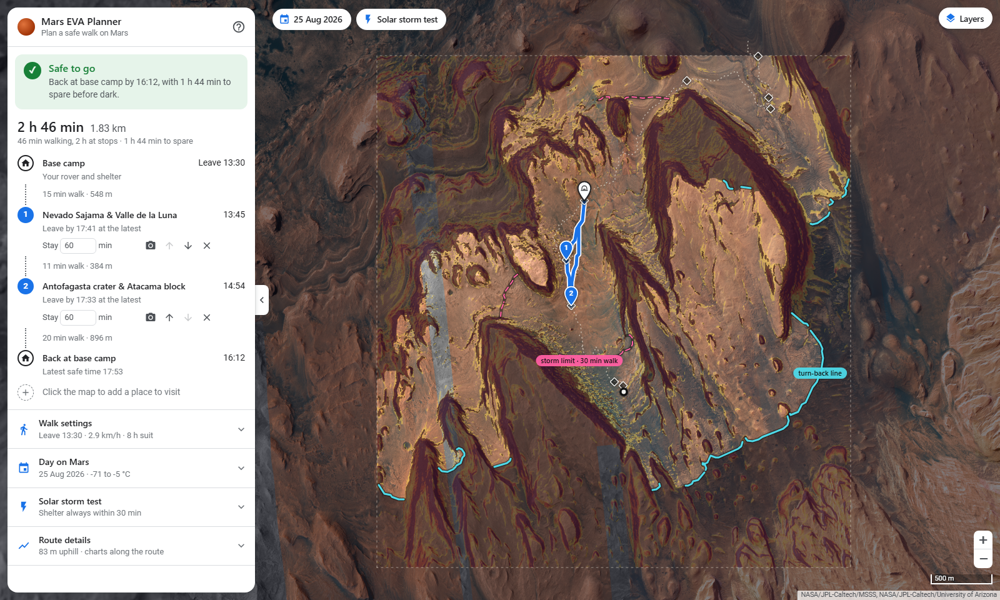

# MarsExplorer

NASA Space Apps Hackathon entry: **Mars EVA Planner**, a planning screen a Mars crew would use in the habitat before walking out to study the boxwork formations on Mount Sharp, Gale Crater.

The crew picks a base camp and science stops on the map. The planner finds a walking route that avoids steep ground, checks it against life support and daylight, and draws the **turn-back line**: the farthest the crew can go, do the planned work, and still walk back in time. Everything is computed from data NASA's Curiosity rover and orbiters collected at this exact place.



The screen is written for people with no space background and laid out like a consumer maps app: a full-screen map with one floating panel. The panel shows only what is needed to decide (the verdict, the total time and distance, and the list of stops, like a directions list). Everything else opens on request: walk settings, the day's weather, the solar storm test, charts along the route, map layers and photos of a place.

## What a crew can do with it

- **Plan a route on foot.** Click the map to add science stops or move base camp. The route follows the fastest walkable ground between steep slopes, and shows distance, climb, walking time and arrival time at each stop.
- **See how far is safe.** Ground beyond the turn-back line is dimmed. Each stop gets a "leave by" time. Rings showing how many minutes on foot each place is from shelter can be switched on in the map key.
- **Get a clear verdict.** "Safe to go", "Tight" or "Not safe", with the reason in one sentence. If the plan runs too long, the map marks where and when to turn back.
- **Run a solar storm drill.** Choose where the crew is when an alert arrives. The planner shows the fastest way back and whether they reach shelter within the warning time. The storm itself is the real one Curiosity recorded on 20 May 2024.
- **Plan against real conditions.** Pick any Martian day (sol) since 2012 and the planner uses the temperature, daylight and radiation Curiosity measured then.
- **Look before you go.** For any point, see the photos Curiosity took from the nearest place it stood, labelled by compass direction.
- **Share a plan.** The plan is stored in the page address, so a link reopens it exactly.

## How it answers the challenge

| The brief asks for | In this tool |
|---|---|
| A science goal and a matching location | Sampling boxwork ridges and hollows on Mount Sharp, where Curiosity has worked since 2025. Preset stops are Curiosity's own drill sites (Altadena, Nevado Sajama and Valle de la Luna, Antofagasta crater). |
| At least three kinds of data, layered | Optical (25 cm colour imagery, rover photos), topographic (1 m elevation, slope), atmospheric (daily weather), radiation (surface dose rate, solar storm). |
| Astronaut safety, radiation and space weather | Turn-back line, walk-back rings, storm line, storm drill, radiation dose for the planned EVA. |
| Suited mobility and a route that avoids obstacles | Walking speed set by the crew and slowed by slope; ground steeper than the crew's limit is no-go. |
| A habitat display, tablet or HUD | A habitat planning screen. |
| Rover point-of-view images | Curiosity's Navcam views in eight compass directions at its stops. |
| Rovers and working in pairs | Base camp is modelled as a pressurised rover parked on ground Curiosity has already driven. |

## Run it

You need Python 3.12 and Node.js 20.19 or newer. The prepared data is in the repository, so nothing has to be downloaded first. Map imagery and photos load from NASA servers, so you need to be online.

```powershell
# 1. Backend (from the repository root)
python -m venv backend\.venv
backend\.venv\Scripts\python -m pip install -r backend\requirements.txt
backend\.venv\Scripts\python -m uvicorn app.main:app --app-dir backend --host 0.0.0.0 --port 8001

# 2. Frontend (second terminal)
cd frontend
npm install
npm run dev
```

Open http://localhost:5173. On macOS or Linux use `backend/.venv/bin/python` instead of `backend\.venv\Scripts\python`.

If port 8000 is already in use in your environment, the app is configured to use port 8001 instead. To serve everything from one port, run `npm run build` in `frontend` and open http://localhost:8001. The backend serves the built frontend when `frontend/dist` exists.

## How it is built

The project is two separate parts with a small HTTP API between them.

```
backend/   Python. Owns all NASA data and every calculation.
frontend/  TypeScript. Draws the map, panels and charts and sends the plan to the backend.
```

**Backend** (FastAPI, NumPy, SciPy): loads the terrain grid, searches routes, works out time limits, the safe-return area and storm exposure, and looks up rover photos. Interactive API documentation is at http://localhost:8001/docs.

| Endpoint | What it returns |
|---|---|
| `GET /api/site` | Study area, map layers, rover path and sites, default plan, setting ranges, data sources |
| `GET /api/conditions?sol=` | Weather and background radiation measured on a sol |
| `GET /api/conditions/history` | Long-term temperature and radiation series |
| `POST /api/plan` | Route, timings, verdict, turn-back point, storm exposure, safe-return area |
| `POST /api/escape` | Fastest way back to base camp from a position, judged against the storm warning |
| `GET /api/photos?lat=&lon=` | Curiosity's photos from its nearest stop |

**Frontend** (TypeScript, Vite, Leaflet, no UI framework): holds only the plan being edited. `src/types.ts` mirrors the API responses.

## NASA data used

| Used for | Dataset | From |
|---|---|---|
| Elevation and slope | [MSL Gale Merged DEM, 1 m](https://astrogeology.usgs.gov/search/map/mars_msl_gale_merged_dem_1m), from HiRISE stereo images | USGS Astrogeology / MSL project |
| Colour imagery, regional imagery, place names | [Curiosity location map](https://mars.nasa.gov/maps/location/?mission=MSL) tiles (HiRISE colour, CTX) | NASA/JPL-Caltech/University of Arizona/MSSS |
| Rover stops, driven path, tilt | [Curiosity waypoints](https://mars.nasa.gov/mmgis-maps/MSL/Layers/json/MSL_waypoints.json) and traverse | NASA/JPL-Caltech |
| Temperature, pressure, UV, sunrise, sunset | [REMS daily weather report](https://mars.nasa.gov/rss/api/?feed=weather&category=msl&feedtype=json), 4,745 sols | NASA/JPL-Caltech/CAB |
| Radiation dose rate, May 2024 solar storm | [RAD reduced data records](https://pds-ppi.igpp.ucla.edu/data/MSL-M-RAD-3-RDR-V1.0/) | NASA PDS Planetary Plasma Interactions node / SwRI |
| Ground photos | [Curiosity raw images](https://mars.nasa.gov/msl/multimedia/raw-images/) | NASA/JPL-Caltech |

Site names and descriptions come from NASA's Curiosity mission blog (links are in the map popups).

## How the planner decides

- **Terrain.** The study area is 3.9 by 4.2 km around Curiosity's boxwork sites, on a grid of 4 m cells. Each cell holds its mean elevation and its steepest slope, taken from the 1 m elevation data after smoothing to that data's real resolution (about 3 m).
- **No-go ground.** Cells steeper than the crew's slope limit (default 20°) cannot be entered.
- **Walking speed.** Speed on level ground is a setting (default 0.8 m/s). Slopes change it by Tobler's hiking function, so uphill and downhill differ and the way out and the way back are searched separately.
- **Route.** Dijkstra's shortest-path search over the grid, minimising walking time. A search of the whole area takes about 0.15 seconds.
- **Time limit.** The tighter of usable life support (capacity minus reserve) and daylight (back before sunset minus a buffer). Sunrise and sunset are the measured values for the chosen sol.
- **Turn-back line.** The edge of the area where walking there, doing the planned work and walking back fits inside the time limit.
- **Storm line.** The edge of the area from which base camp can be reached within the storm warning time.
- **Radiation.** The dose for an EVA is the background dose rate Curiosity measured around that sol times the hours outside. Sieverts are estimated with a mean quality factor of 3.05 (Hassler et al. 2014).

### Checked against the rover

At Curiosity's 263 stops inside the study area, the terrain grid differs from the elevation the rover recorded by 0.06 m on average. Slope on the grid at those stops (median 9.5°) matches the tilt the rover measured (median 8.6°), with a correlation of 0.53. Run `build_terrain.py validate` to reproduce this.

### What the radiation data shows

- Background dose rate at the surface follows the solar cycle: about 8.5 µGy/h in 2012, 13 µGy/h at solar minimum in 2020, and about 6 µGy/h in 2024 to 2026.
- In the 20 May 2024 storm the dose rate rose from 5.5 to 351 µGy/h (64 times) within 54 minutes. Over 44 hours the event added about 1.7 mGy, as much as 13 sols of normal background.

## Limits to know about

- Slopes come from 1 m elevation data. Rocks and ledges smaller than a few metres, and soft sand, are not seen.
- The walking model was derived for hikers on Earth. Suited walking on Mars is uncertain, which is why speed and slope limit are settings.
- Conditions are a replay of measured sols, not a forecast. Weather is daily minimum and maximum only.
- Background radiation is one reading every second sol, smoothed over 40 sols. The storm drill uses one recorded event and counts dose outdoors only; shielding inside the shelter is not modelled.
- The storm warning time is an assumption the crew sets.

## Rebuilding the data

The files in `backend/data` are produced by scripts in `backend/pipeline`. Run them only to refresh the data. Raw downloads are cached in `backend/data/cache`, which git ignores.

```powershell
backend\.venv\Scripts\python backend\pipeline\build_rover.py      # rover stops, path, study sites
backend\.venv\Scripts\python backend\pipeline\build_weather.py    # daily weather
backend\.venv\Scripts\python backend\pipeline\build_terrain.py    # elevation and slope; downloads about 330 MB
backend\.venv\Scripts\python backend\pipeline\build_radiation.py  # radiation; downloads about 520 MB
backend\.venv\Scripts\python backend\pipeline\build_photos.py     # photos for the named sites
```

The elevation file is 3.9 GB, so `build_terrain.py` downloads only the rows that cover the study area.

## Tests

```powershell
backend\.venv\Scripts\python -m unittest discover -s backend/tests -v   # planner and mission logic, 20 tests
cd frontend; npm run typecheck                                          # TypeScript
```

## Repository layout

```
backend/
  app/         API (main.py), route search (planner.py), mission logic (mission.py),
               conditions, photos, terrain, site description
  pipeline/    scripts that build backend/data from NASA sources
  data/        prepared data: terrain grid, weather, radiation, rover stops, photo lists
  tests/
frontend/
  src/         main.ts (wiring), map.ts, panels.ts, charts.ts, api.ts, types.ts, permalink.ts
docs/          screenshot
```

## Credits

Data and imagery: NASA, JPL-Caltech, USGS Astrogeology, University of Arizona, MSSS, CAB, SwRI and the PDS. Map library: Leaflet.
Team:
Kartik Rana (Lead dev)
Aditya Kumar(visualization)
